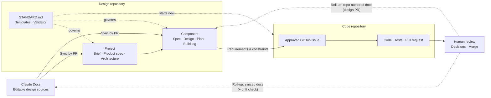
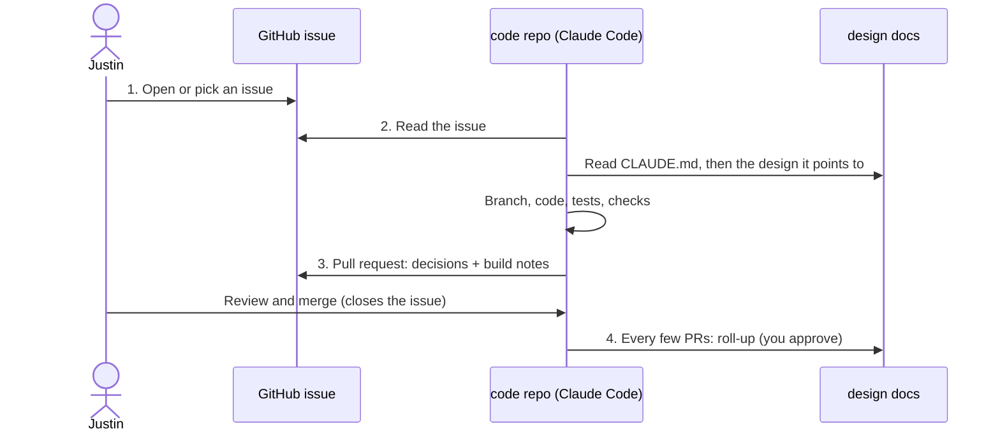

# Design

The design docs for everything Justin builds: one folder per project, written while the
work is being built rather than reconstructed afterward. Code repositories don't keep
design docs; they read them from here.

## Projects

| Project | Folder | What it is |
| --- | --- | --- |
| Construction OS | [construction-os/](construction-os/) | A company-specific AI system for residential builders. Components: the [corpus](construction-os/corpus/) — the company's governed knowledge — the [document workbench](construction-os/document-workbench/) — retrieval, pricing and drafting — and the [intake router](construction-os/intake-router/), which classifies inbound messages and routes them to a workflow. |
| Agents | [agents/](agents/) | Small agents built to learn how agent loops work, starting with a job evaluator. Component: the job evaluator. Code in [`agents`](https://github.com/justinyurasits/agents). |
| Construction OS demos | [construction-os-demos/](construction-os-demos/) | Standalone tools in the same domain: Fieldscope (subcontractor safety compliance) and the PCO Generator (live at draftconstructionchangeorder.com). |
| JustinYurasits.com | [justinyurasits-com/](justinyurasits-com/) | Justin's personal website: writing, AI projects and consulting for enterprise AI and construction audiences. Brief in draft. |

Visual design (colors, type, marks, components) is the one exception. It lives in
[`brand-system`](https://github.com/justinyurasits/brand-system), and design docs that
need a visual rule point there.

## How it works

**1. A project is a folder; a component is a subfolder.** Every component has the same
files from the day it's created: README, brief, spec, design, plan, build log, sync
manifest, images. A project adds a brief and, as it grows, principles, a product spec and
an architecture doc. Every file has one job.

**2. Docs are written in Claude Docs or here.** Most are drafted in a Claude Doc and
synced into this repo by pull request, so the history shows what changed and when. The
Claude Doc is the working copy; the file here is the reviewed record and is never edited
by hand. A few docs, like the agents docs, are written here directly, also by pull
request.

**3. Code repos read from here.** Each code repository's `CLAUDE.md` points Claude Code
at its project and component folder and says what to read first. Design leads, code
follows: a change to what the product does is made here (or in its Claude Doc) first,
and the code pull request cites it.

**4. Work runs through GitHub.** Issues, pull requests and roll-ups, described step by
step in [How work flows](#how-work-flows) below. Nothing enters the record without
Justin's approval.

**5. The structure is checked.** `python tools/validate.py` runs on every pull request
and fails if a project or component is missing a file or a sync record is wrong.

The rules behind all of this are in [STANDARD.md](STANDARD.md). Where this page and the standard differ, the standard is right.

## How work flows

### The everyday loop

Most implementation work follows a design that's already approved. Claude Code works
from a GitHub issue, implements and tests the change, and opens a pull request.
Important decisions and findings come back into the design through reviewed roll-ups.

`plan.md` and issues do different jobs. A component's `plan.md` holds the milestones
ahead, each with an exit criterion. A GitHub issue authorizes one bounded task within a
milestone (or a bug or small fix), which is what "the issue is the plan" means.

| Step | Who | What changes |
| --- | --- | --- |
| **1. Issue** | You, or Claude from the plan | A GitHub issue in the code repo: what to build, which design section it follows, and the acceptance criteria. The issue is the plan. |
| **2. Build** | Claude Code | Code and tests on a branch `issue-<N>-…`. Claude Code reads the issue first, then its `CLAUDE.md` and the design the issue depends on, in order (brief, spec, design, plan). Nothing in `design` changes. |
| **3. Review** | Claude Code opens it, you merge | The PR records **Decisions (proposed)**, the implementation choices made while coding, and **Build notes**, what happened and what it taught. The checks run. Merging approves the decisions and closes the issue. |
| **4. Roll up** | Claude Code proposes, you approve | After a merge, a finished milestone or about every ten turns. Decisions go to the component's `design.md` log, findings to its `build-log.md`, and any lesson that generalizes to the project's `principles.md`. A finished milestone leaves `plan.md`. Synced docs get these as suggestions in the Claude Doc, then a sync PR; repo-authored docs get a PR in `design`. |

### Other paths

**The product should do something different.** Start one step earlier. Write the change
in the Claude Doc (the component's `spec` for what it must do, its `design` for how, or
the project's `product-spec`), sync it into `design` by PR, add a milestone to `plan.md`
if it adds work, then open the issue. From there it's the everyday loop.

**The design is silent or wrong mid-build.** Claude Code stops and says what's missing.
You decide, the change goes into the Claude Doc (or a `design` PR) and is merged, and
then the build continues against it. A design change never rides inside a code PR.

**A Claude Doc moved ahead of its synced copy.** Someone edited the doc and nobody
synced. The roll-up's drift check compares each manifest's revision with the doc's and
offers a sync PR. Until then, the Claude Doc is the current version.

**Something new: a project, a component or a code repo.** Copy the matching folder from
`_template/` (`project/`, `component/` or `repo/`), fill it in, and open a PR. A new
project also gets a row in the table above; a new code repo fills in section 7 of its
`CLAUDE.md`.

### How often each design file changes

Typical, not a rule.

| File | Changes | When |
| --- | --- | --- |
| `build-log.md` | Often | Every roll-up |
| `plan.md` | Each milestone | A milestone is added or finished |
| `design.md` | Sometimes | A roll-up brings a decision, or you change how it works |
| `principles.md` | Occasionally | A roll-up finds a lesson that applies beyond one piece of work |
| `spec.md`, `product-spec.md` | Rarely | You change what the product must do |
| `brief.md` | Almost never | Who it's for or why changes |
| `sync-manifest.yaml`, `DOCS.md` | With every sync | Written by the sync, never by hand |

## The files at the top

| File | Its one job |
| --- | --- |
| `README.md` | This page: what the repo is and how it works. |
| [`STANDARD.md`](STANDARD.md) | The rulebook. Every file type and its job, naming, front matter, and the rules for how design and code work together. When this page and the standard differ, the standard is right. |
| [`CLAUDE.md`](CLAUDE.md) | Instructions for Claude Code working in this repository. |
| [`DOCS.md`](DOCS.md) | An index of every synced doc: its Claude Doc link, where it syncs to, revision and date. Rebuilt from the manifests by `python tools/build_docs.py`; never edited by hand. |
| `sync-manifest.yaml` | The sync record for the files at the top (today, `STANDARD.md`). Every folder with synced files has one. |
| [`_template/`](_template/) | The standard as files: `project/`, `component/`, and `repo/` (what every code repository starts with). |
| `tools/validate.py` | The structure check. |
| `tools/build_docs.py` | Rebuilds DOCS.md from the sync manifests. Run it after any sync. |

## Adding something

See *Something new* under [Other paths](#other-paths). Every change is a branch and a pull request. Never commit to main.
